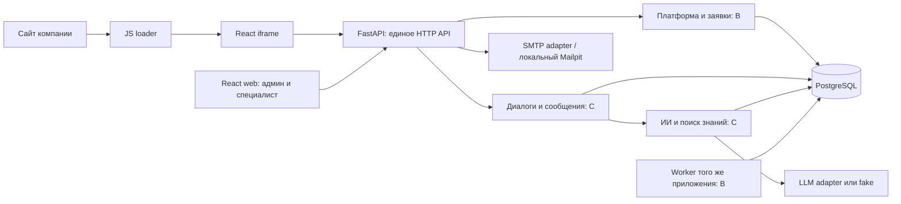

# Архитектура и решения

Статус: план для разработки, 16 ноября 2026. Пользователь выбрал Python;
остальные решения ниже — предлагаемые значения по умолчанию. Они позволяют
начать маленькие задачи, не возводя инфраструктуру полноценного SaaS.

## Рассмотренные варианты

| Подход | Выигрыш | Цена | Решение |
|---|---|---|---|
| FastAPI + React + PostgreSQL, модульный монолит | Независимые UI/API, мало сервисов, Python для ИИ | Два языка и явный контракт | Выбран как исходный план |
| Django + серверные шаблоны/HTMX | Готовые auth/admin/ORM | Отдельный виджет всё равно нужен, меньше независимости UI | Хороший запасной путь, не смешивать с FastAPI |
| Несколько backend-сервисов + брокер + vector DB | Раздельное масштабирование | Больше интеграций, деплоя и контекста ИИ | За пределами учебного ядра |

## Состав



Один репозиторий, один backend-образ. HTTP API и отдельный worker используют
один код и одну БД. Для ранних писем B01 даёт enqueue/drain_once, C05 —
ai_run runner внутри API с восстановлением pending runs; постоянный
планировщик B09 появляется отдельно. Начинаем с одного
экземпляра API, сообщений через REST и опроса раз в 3 секунды при открытом
диалоге. Streaming, WebSocket, Redis и Celery не нужны для защиты.

## Стек и воспроизводимость

| Часть | Решение | Кто фиксирует версии |
|---|---|---|
| Backend | Python 3.12, FastAPI, Pydantic v2 | B01: `.python-version`, `pyproject.toml`, `uv.lock` |
| Данные | PostgreSQL 17, SQLAlchemy 2.x, psycopg 3, Alembic | B01, стабильные совместимые релизы |
| Frontend | Node.js 24 LTS, npm workspaces, React, Vite, TypeScript strict | A01: `engines`, lockfile |
| UI | React Router, TanStack Query, обычный CSS; готовые доступные primitives по необходимости | A01, не создавать свою UI-библиотеку |
| Проверки | pytest + httpx/TestClient, Ruff, ty; Vitest + Testing Library, MSW, Playwright | A01/B01 |
| ИИ | Один тонкий provider adapter + fake, Pydantic-валидация результата | C01/C04 |
| Документы | TXT в ядре; pypdf + python-docx в расширении | C09 |
| Семантический поиск | PostgreSQL FTS в ядре; pgvector в расширении C09 | C09, не отдельная БД |

Не использовать `latest` в CI и не выдумывать номер текущего релиза.
Точные patch-версии библиотек выбираются при A01/B01 после проверки
совместимости и фиксируются lock-файлами. Node 24 остаётся поддерживаемой
LTS-веткой; статус сверяется по [Node.js releases](https://nodejs.org/en/about/previous-releases).

## Границы кода

```text
apps/web/src/features/          # A: auth, inbox, admin, knowledge, analytics
apps/widget/src/                # A: iframe, loader, history, chat
packages/api-client/src/        # A: generated.ts + fetch wrapper
backend/src/ips/
  main.py                      # B: app factory и сборка зависимостей
  core/                        # B: config, db, errors, context, ports, jobs
  platform/                    # B: auth, organizations, members, widgets, customers
  tickets/                     # B: handoff, assignment, statuses, routing, metrics
  conversations/               # C: conversations, messages, attachments
  ai/                          # C: provider, orchestration, assistant
  knowledge/                   # C: articles, revisions, retrieval, imports
backend/alembic/versions/       # B/C: новые файлы своих доменов
contracts/                     # Все: только через отдельные PR контракта
tests/e2e/                     # A; B/C дают фикстуры и проверку backend-границ
infra/                         # B: compose, deployment, backup instructions
```

Внутри домена: `router.py`, `schemas.py`, `service.py`, `repository.py`,
`models.py`; сложную логику выделять в именованный файл по поведению.
Не создавать пять пустых слоёв для простого endpoint. Сервисы получают
Session/порты аргументами, не ищут их через глобальные singleton.

## Транзакции и вызов ИИ

SQLAlchemy sync Session — на один запрос/единицу работы, никогда не общая
для потоков. Синхронные DB-обработчики объявлять `def`; sync LLM HTTP-вызов
исполняется вне DB-транзакции в том же worker thread. Не блокировать event
loop синхронным I/O внутри `async def`.

1. C сохраняет сообщение с уникальным `client_message_id`; повтор возвращает
   сохранённый объект. Worker/повторный запрос подбирает незавершённую AI job.
2. Короткая транзакция создаёт `ai_run` и резервирует лимит. Одна активная
   генерация на conversation, входящие сообщения сохраняются независимо.
3. Поиск только по разрешённым публичным статьям этого widget и tenant.
4. Провайдер получает ограниченный контекст и timeout 20 s. Вызов не держит
   блокировку строки и открытый DB transaction.
5. Перед сохранением ответа сервис снова блокирует conversation и проверяет
   `mode=bot` и версию. Если человек подключился во время генерации,
   результат помечается discarded и клиенту не отправляется.
6. Ошибка/таймаут сохраняется в ai_run; клиент может вызвать handoff независимо
   от ИИ. Ограниченный retry только до записи ответа, без дублирующих сообщений.

Про Session и транзакции: [SQLAlchemy](https://docs.sqlalchemy.org/en/20/orm/session_basics.html).
В тестах dependencies заменяются через стандартный механизм
[FastAPI](https://fastapi.tiangolo.com/advanced/testing-dependencies/).

## Безопасность, достаточная для честного прототипа

Обязательны tenant-фильтры и отрицательные тесты, RBAC, серверная проверка
статусов, хеширование паролей Argon2, случайные session tokens с хранением
хеша, HttpOnly cookie, CSRF для staff mutations, ограниченные customer tokens,
проверка домена и отсутствие секретов в JS. CORS и Origin — браузерный барьер,
но не доказательство личности клиента.

Суперадминистратор имеет отдельные агрегированные endpoint; его роль сама
по себе не даёт чтение сообщений/внутренних статей компаний.
RLS, внешнее объектное хранилище и несколько реплик — дальнейшее усиление,
а не замена серверной авторизации.

## Развёртывание

Для защиты: Docker Compose (API, PostgreSQL, статические web/widget, SMTP
песочница; AI runner в ядре, постоянный worker с M5). Без платной облачной зависимости.
Для публичного демо: один VPS, TLS reverse proxy, persistent volumes,
резервная копия PostgreSQL и проверка восстановления. Production-пробелы
перечислены отдельно в `docs/risks.md`.
