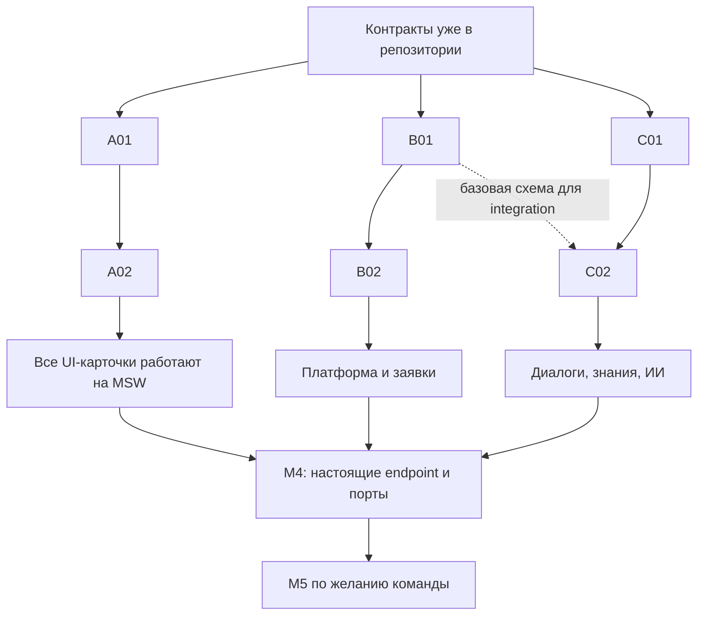

# План на троих

План ориентирован на проверяемые результаты, без искусственных дедлайнов.
Все три участника работают параллельно, один PR — одна карточка или её
проверяемая часть. Модели получают одну карточку, а не весь список.

| Этап | A: интерфейсы | B: платформа | C: диалоги/ИИ | Проверяемый результат |
|---|---|---|---|---|
| M0, по 8 | A01 3 + A02 5 | B01 3 + B02 5 | C01 3 + C02 5 | UI на MSW, backend auth, диалоги; одна schema и общий контракт |
| M1, по 8 | A03 + A04 | B03 + B04 | C03 + C04 | Виджет и login, handoff, база знаний и provider adapter |
| M2, по 8 | A05 + A06 | B05 + B06 | C05 + C06 | Рабочее место, безопасное назначение, ИИ с fallback |
| M3, по 4 | A07 | B07 | C07 | Email continuation, ответы человека, outcome и метрики |
| M4, по 4 | A08 | B08 | C08 | Сквозной стенд и сценарий защиты; ядро принято |
| M5, по 8 | A09 + A10 | B09 + B10 | C09 + C10 | Интеллектуальные функции и расширенное управление |
| **Всего** | **40 (ядро 32)** | **40 (ядро 32)** | **40 (ядро 32)** | **120 баллов, 30 карточек** |

Каждая карточка после первых двух имеет 4 балла. Баллы отражают относительную
нагрузку с тестами и review, а не количество строк или точное число часов.
Равное количество баллов — начальная гипотеза; фактический баланс корректируется
по времени после каждого этапа. Порядок: `docs/team-workflow.md`.

## Зависимости, которые действительно блокируют

Зависимости соседнего сервиса подменяются согласованным fake на unit-уровне.
Это не отменяет integration tests. Единственный ранний общий барьер — schema
b0001 и порты B01; C до него выполняет C01 и unit-часть C02, A — весь MSW.
Новый endpoint можно подключать в UI по одному PR, не ждать завершения этапа.

## Точки сдачи

- M0: каждый показывает свой запуск и проверку, не только структуру папок.
- M1: на тестовых данных виджет получает основанный на статье ответ;
  handoff создаёт заявку. Интерфейс может ещё работать на MSW, что явно отмечено.
- M2: гонки назначения и handoff/ИИ проходят backend tests; UI готов к real API.
- M3: письмо в sandbox, продолжение диалога на другом устройстве, подтверждение.
- M4: 10-минутный сценарий из verification проходит целиком без MSW;
  для fake LLM есть видимое обозначение и отдельный real-provider smoke.
- M5: демонстрация импорта и ассистента, которые не публикуют знания и ответы
  без требуемой проверки; SLA и retention работают с управляемым временем.

Планы исполнителей: `docs/plans/track-a.md`, `track-b.md`, `track-c.md`.
Реестр карточек для автоматической проверки: `docs/tasks.json`.
